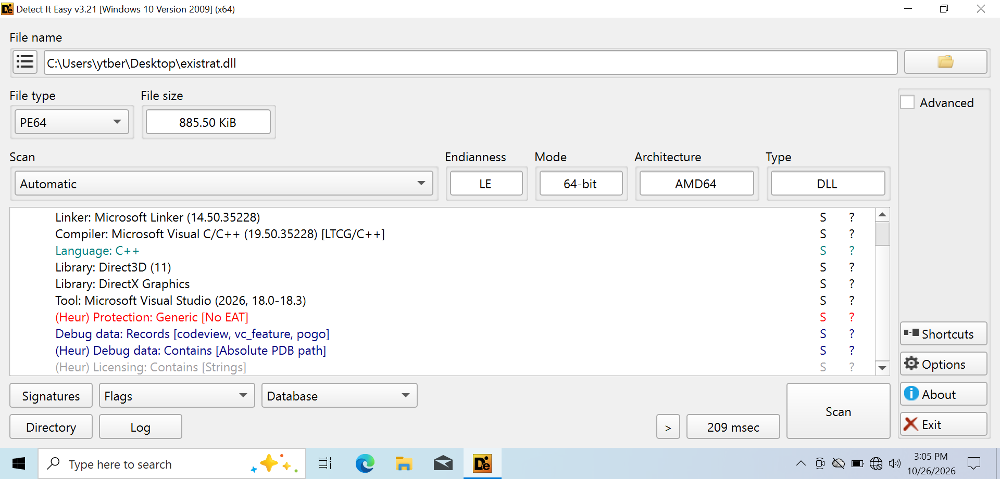
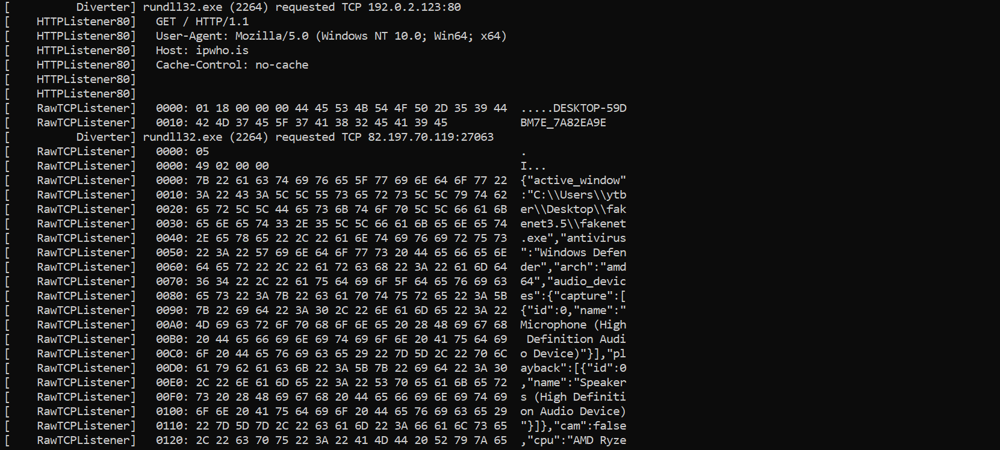
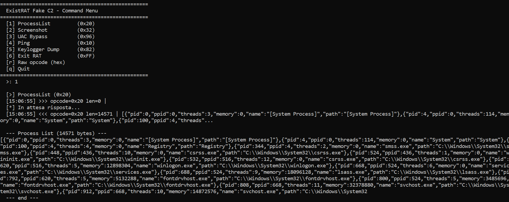
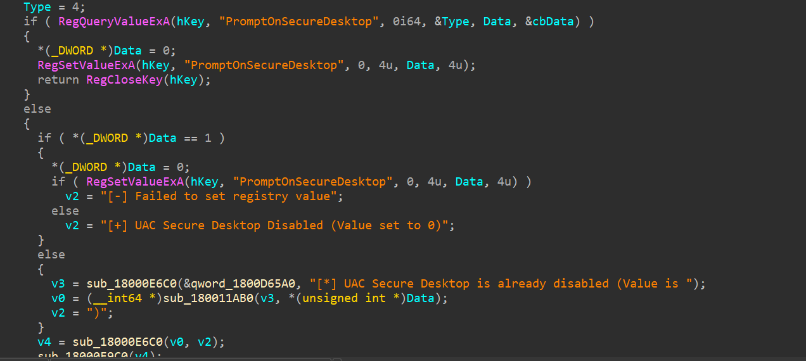
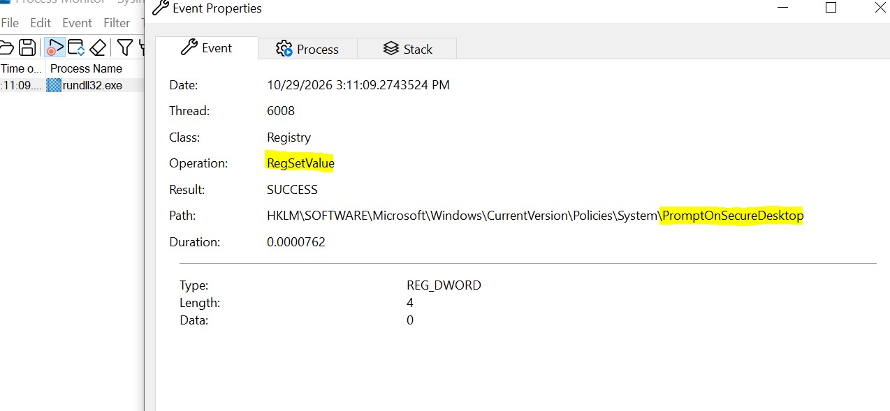
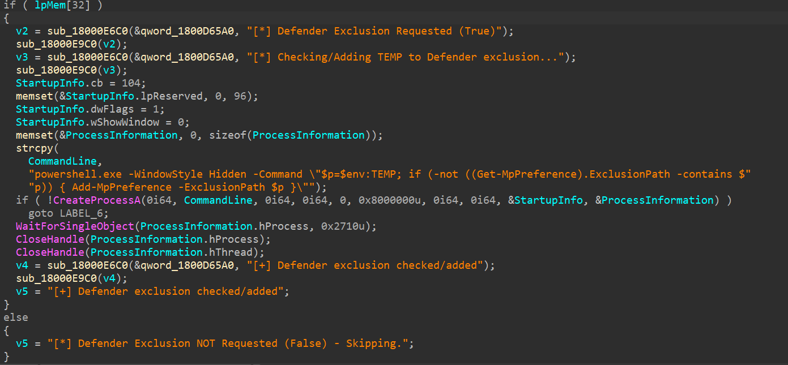

# ExistRAT: Reversing a C++ RAT and Taking It Over With a Fake C2

## TL;DR

ExistRAT is a native C++ Windows RAT shipped as a 64-bit DLL. When I picked it up there was no public analysis of it, so I reversed it from scratch in IDA Pro, then wrote my own C2 and took control of it.

- No packer, no obfuscation, no anti-debug, no anti-VM. Static analysis alone mapped the whole command set.
- The C2 is hardcoded in plaintext: `82.197.70.119:27063`.
- Custom TCP protocol, `[1 byte opcode][4 byte length][payload]`, with no encryption and no authentication.
- The moment it connects, with no operator action, it sends a full system fingerprint, geolocates the victim through ipwho.is, starts a reverse shell and a keylogger, goes after Discord tokens, and reports the victim's active window every 10 seconds.
- Capabilities: keylogging, screen capture and streaming, webcam and microphone capture, remote shell, remote mouse and keyboard, file manager, registry editor, download and execute with a Microsoft Defender exclusion, and disabling the UAC secure desktop.
- I wrote a fake C2 in PowerShell, redirected the RAT to it and drove it. The process list, the UAC secure desktop change and the Defender exclusion command were confirmed dynamically, and the detection rules were retested under a second DLL host.

## Sample

| Field | Value |
| --- | --- |
| SHA256 | `a4f5aac004626bcc71ba94695ed4445825cd81382121ea959c0df69c0ae02ae0` |
| File | `existrat.dll`, 885 KB |
| Type | PE32+ DLL (x64), no export table |
| Compiler | MSVC 19.50 (Visual Studio 2026), C++ with LTCG, per Detect It Easy |
| Packer / protector | None |
| Source | [Triage report 261002-q192la1tex](https://tria.ge/261002-q192la1tex) |
| PDB path | `C:\Users\mdrab\3D Objects\rat\ExistRAT-Client\ExistRAT-Client\build\Client.pdb` |

## Why this sample, and how I approached it

ExistRAT had just come out and nobody had written it up yet. That's exactly why I picked it: I wanted a sample I had to work out myself, not one I could check against someone else's report.

The author left the PDB path in the binary, and it names the project `ExistRAT-Client`. Detect It Easy showed a plain MSVC build: no packer, no protector, no obfuscation. For a C++ RAT that's unusual, and it meant I could skip unpacking and drop it straight into IDA.

So the static part is pure IDA: from `DllMain` to the main thread, to the C2 config, to the command dispatcher, renaming every handler as I went. Then I switched to dynamic analysis to prove what I had read.


*Figure 1. Detect It Easy: PE64 DLL, MSVC 19.50 (Visual Studio 2026), no packer. The only "protection" hit is a heuristic for the missing export table, and the absolute PDB path is still in the debug data.*

One detail matters for running it: the DLL has no exports at all. Everything starts in `DllMain`, so anything that loads it runs the RAT. In the lab I used `rundll32.exe existrat.dll,x` with a dummy entry name: rundll32 complains the entry is missing, but by then the RAT thread is already running.

## Execution flow

```
existrat.dll  (no exports, loaded with rundll32 in the lab)
 |  DllMain 0x18000E390 -> CreateThread(RAT_MainThread)
 v
RAT_MainThread  0x18000C010
 |  Winsock init, collect hostname / CPU / GPU / RAM
 v
C2_Connect  0x180051440                                       <-----+
 |  TCP 82.197.70.119:27063, TCP_NODELAY + SO_KEEPALIVE              |
 |  retry every 3 s until the server answers                         |
 v                                                                   |
Registration                                                         |
 |  0x01 HWID -> GET http://ipwho.is/ -> 0x05 fingerprint JSON       |
 |  0xA0 UDP port, wait up to 5 s for the 0xA1 ACK                   |
 v                                                                   |
Automatic actions (no operator command needed)                       |
 |  Shell_AutoStart: cmd.exe with redirected pipes                   |
 |  keylogger, Discord token theft                                   |
 |  Heartbeat_ActiveWindow: 0x10 every 10 s                          |
 v                                                                   |
Command loop                                                         |
    recv [opcode][length][payload] -> switch on the opcode           |
    connection lost -------------------------------------------------+
```

Everything above the command loop runs on its own. When the connection drops, the RAT goes back to `C2_Connect` and registers from scratch, which is why FakeNet saw the full handshake every few seconds.

## Finding 1: a plaintext C2 protocol with no authentication

The C2 address is not encrypted or decoded at runtime. `82.197.70.119` sits in plaintext at `0x1800B6D10` and a static initializer (`Init_C2Host`, `0x180001000`) copies it into a global. The port, 27063, is an immediate value inside `C2_Connect` (`0x180051440`), which also sets `TCP_NODELAY` and `SO_KEEPALIVE` and retries every 3 seconds until the server answers.

Every message in both directions has the same shape:

```
+--------+---------------------+-------------------+
| opcode | length (uint32, LE) |      payload      |
| 1 byte |       4 bytes       |   length bytes    |
+--------+---------------------+-------------------+
```

`C2_SendPacket` (`0x180051840`) writes it straight to the socket with `send()`, in 64 KB chunks. No encryption, no compression, no message signature.


*Figure 2. FakeNet catching the start of a session: `rundll32.exe` fetching `http://ipwho.is/`, then the `0x01` HWID packet and the beginning of the `0x05` fingerprint JSON, readable as plain text right in the hex dump.*

The receive loop in `RAT_MainThread` reads 1 byte (the opcode), then 4 bytes into a DWORD (the length), then the payload, and dispatches on the opcode. The only check is a 100 MB cap (`0x6400000`) on the length. Nothing proves the server is the real operator, so anyone who owns that IP or redirects the traffic can command the bot. That's what I did in Finding 4.

Registration happens in a fixed order:

| Direction | Opcode | Payload |
| --- | --- | --- |
| RAT → C2 | `0x01` | HWID, `HOSTNAME_XXXXXXXX` (in my lab `DESKTOP-59DBM7E_7A82EA9E`) |
| RAT → C2 | `0x05` | System fingerprint as JSON |
| RAT → C2 | `0xA0` | 2-byte local UDP port, for audio and screen streaming |
| C2 → RAT | `0xA1` | ACK. The RAT waits 5 seconds for it, then continues anyway |
| RAT → C2 | `0x02` | Reverse shell output, starting with the `cmd.exe` banner |
| RAT → C2 | `0x10` | Heartbeat every 10 seconds, carrying the title of the victim's foreground window |
| C2 → RAT | `0x10` | Ping. The RAT answers with an empty `0x10`: `10 00 00 00 00` |

The same opcode `0x10` goes both ways with two meanings: the C2 uses it as a ping, the RAT as a heartbeat. The heartbeat comes from its own thread, `Heartbeat_ActiveWindow` (`0x18000BE70`). While the global connected flag is set, it sleeps 10 seconds, reads the foreground window title with `GetWindowTextA` and sends it, whether or not the window changed.

## Finding 2: what it does the second it connects

Before the operator types anything, ExistRAT has already profiled the machine, opened a shell and started spying.

| Action | Where | How I confirmed it |
| --- | --- | --- |
| Sends a system fingerprint (opcode `0x05`) | `RAT_MainThread` (`0x18000C010`) | Captured on the wire (FakeNet and my C2) |
| GeoIP lookup: `GET http://ipwho.is/` | `RAT_MainThread` | Captured with FakeNet, on every reconnect |
| Starts a reverse shell (`cmd.exe`) | `Shell_AutoStart` (`0x18006E620`) | IDA, and observed: the banner arrives with no `0x02` sent by my C2 |
| Starts the active-window heartbeat (`0x10`, every 10 s) | `Heartbeat_ActiveWindow` (`0x18000BE70`) | IDA, and observed on the wire |
| Starts the keylogger | `AutoStart_Keylogger` (`0x18000BA20`) | Static, IDA |
| Steals Discord tokens | `AutoSteal_DiscordTokens` (`0x18000DE70`) | Static, IDA |

The reverse shell surprised me. In IDA, `Cmd02_RemoteShell` is only reached from the command switch, so I first assumed the shell needed an operator command. But my C2 never sent `0x02` and the `cmd.exe` banner arrived anyway. Following the calls to `CreateProcessA` answered it: right after logging `[*] Waiting for commands...`, `RAT_MainThread` calls `Shell_AutoStart`, which creates two pipes and spawns `cmd.exe` with its input and output redirected. That happens on every connection, before the command loop starts. Opcode `0x02` only writes the operator's command into the shell's input pipe, restarting `cmd.exe` first if it has died.

This is the fingerprint the operator gets, captured by my fake C2:

```json
{
  "active_window": "RunDLL",
  "antivirus": "Windows Defender",
  "arch": "amd64",
  "audio_devices": {
    "capture": [{"id": 0, "name": "Microphone (High Definition Audio Device)"}],
    "playback": [{"id": 0, "name": "Speakers (High Definition Audio Device)"}]
  },
  "cam": false,
  "cpu": "AMD Ryzen 5 7535HS with Radeon Graphics",
  "gpu": "VirtualBox Graphics Adapter (WDDM)",
  "hostname": "DESKTOP-59DBM7E",
  "hwid": "DESKTOP-59DBM7E_7A82EA9E",
  "is_admin": true,
  "mic": true,
  "monitors": 1,
  "net_info": {},
  "os": "Windows 10.0 (Build 19045)",
  "ram": "5.6 GB",
  "username": "ytber",
  "wifi": true
}
```

It tells the operator at a glance whether the victim is admin, which antivirus is installed, and whether a microphone and webcam are there to spy with. Installed, not running: my VM reported `Windows Defender` even though I had Defender disabled. `active_window` is the title of whatever window the victim has in front. In my lab it was the rundll32 error box.

The Discord grabber (`Grab_DiscordTokens`, `0x180007890`) walks 5 Discord clients and about 20 Chromium-based browsers, sends what it finds to the C2 and drops `%TEMP%\sys_debug_log.bin`. My VM had no Discord installed, so I only confirmed this one statically.

## Finding 3: the command set

The dispatcher in `RAT_MainThread` is a single switch on the opcode, and I mapped and renamed every handler. The switch has 52 cases, but two of them, `0x46` and `0x90`, are empty: they hit a bare `break` and do nothing. That leaves 50 working commands, covering spying, full remote control of the machine, and delivery of further payloads.

| Category | Opcodes | What the operator can do |
| --- | --- | --- |
| Remote shell | `0x02` | Send commands to the auto-started `cmd.exe` |
| Surveillance | `0x32`, `0x3A`–`0x3B` | Screenshot, live screen stream start and stop |
| Surveillance | `0x80`–`0x82` | Keylogger start, stop, dump |
| Surveillance | `0x83`, `0x84`–`0x87` | Webcam snapshot, microphone capture with UDP streaming |
| Remote control | `0x3C`, `0x3D`, `0x3E` | Block the victim's input, send mouse and keyboard input, turn the monitor off and block input |
| Remote control | `0x31`, `0x37`, `0x39` | Open a URL, pop a message box, shut down or reboot |
| Remote control | `0x89`, `0x8A`, `0x8C`, `0x8D` | Play audio on the victim's machine |
| Processes | `0x20`, `0x21` | List processes, kill a process |
| Files | `0x41`–`0x45`, `0x49`–`0x4E`, `0x50`–`0x51` | List, download, upload, delete, rename, copy, create folders |
| Registry | `0x60`–`0x65` | Read, create, modify and delete keys and values |
| Persistence | `0x70`–`0x72` | List the HKCU and HKLM `Run` and `RunOnce` entries, add or delete a value under `HKCU\Software\Microsoft\Windows\CurrentVersion\Run` |
| Payload delivery | `0x40` | Download and execute, with an optional Defender exclusion (Finding 5) |
| Defense evasion | `0x96` | Disable the UAC secure desktop (Finding 4) |
| Session | `0x10`, `0xFF` | Ping (answered with an empty pong), terminate |

What's missing is just as telling: there is no built-in persistence at startup. The RAT only survives a reboot if the operator sends `0x71`, with a `Name|Path` payload that the handler writes as a `REG_SZ` value under the HKCU `Run` key. That key needs no admin rights.

## Finding 4: taking it over with my own C2

Once I understood how ExistRAT talks to its C2, I wrote the protocol down and built a fake C2 that speaks it. Reading the code tells you what the RAT could do. Sending it commands and watching it obey proves what it does.

I wrote it in PowerShell. A proper tool in C++ would be nicer, but PowerShell is already in the VM, so there was nothing to install or copy over from my main machine. Quick and dirty, and it did the job: it accepts the connection, parses the registration packets, sends the `0xA1` ACK, then gives me a menu of commands and saves every packet to disk.

**Redirecting the RAT.** The C2 is a raw IP, not a domain, so the hosts file can't redirect it. Instead I added the C2's IP as a second address on the VM's network adapter, so the RAT's `connect()` lands on my listener:

```
netsh interface ip add address "Ethernet" 82.197.70.119 255.255.255.0
```

The hosts file was only used to send `ipwho.is` to localhost.

**Process list (`0x20`).** The command is five bytes, `20 00 00 00 00`: opcode `0x20`, length 0, no payload. The RAT answered with 14,571 bytes of plaintext JSON, one object per process:

```json
[{"pid":4,"ppid":0,"threads":114,"memory":0,"name":"System","path":"System"},
 {"pid":620,"ppid":516,"threads":5,"memory":12898304,"name":"winlogon.exe","path":"C:\\Windows\\System32\\winlogon.exe"},
 {"pid":688,"ppid":524,"threads":9,"memory":18096128,"name":"lsass.exe","path":"C:\\Windows\\System32\\lsass.exe"},
 ...]
```


*Figure 3. My fake C2 sends `0x20` and gets back 14,571 bytes of plaintext JSON with every process on the victim.*

**Disabling the UAC secure desktop (`0x96`).** In IDA, the `0x96` handler calls `RegSetValueExA` on `PromptOnSecureDesktop`:


*Figure 4. The `0x96` handler in IDA: read `PromptOnSecureDesktop`, write 0, log the result.*

The handler reads the current value first with `RegQueryValueExA`. If it is 1, it writes 0 and logs `[+] UAC Secure Desktop Disabled (Value set to 0)`. If it is already 0, it only reports it. If the read fails, it writes 0 anyway.

Then I sent the command with Process Monitor filtered on that value:

| Field | Value |
| --- | --- |
| Process | `rundll32.exe` |
| Operation | `RegSetValue` |
| Path | `HKLM\SOFTWARE\Microsoft\Windows\CurrentVersion\Policies\System\PromptOnSecureDesktop` |
| Type / Data | `REG_DWORD` / `0` |
| Result | `SUCCESS` |


*Figure 5. Process Monitor catching the write after I sent `0x96`: `RegSetValue` on `PromptOnSecureDesktop`, `REG_DWORD` 0, `SUCCESS`.*

With this value at 0, UAC prompts are no longer shown on the isolated secure desktop but on the user's normal desktop, where the RAT's screen capture can see them. Writing under HKLM needs admin rights, so this is a post-elevation step that weakens UAC for later. In theory the operator could then watch a prompt through the screen stream and click it with the remote input command (`0x3D`). I didn't test that part.

**What didn't work in my lab.** The webcam snapshot (`0x83`) got no answer: my VM has no camera (`"cam": false` in the fingerprint). That capability is confirmed statically only. The screenshot reply (`0x32`) was lost behind a `0x10` heartbeat, because my C2 reads only one reply per command.

## Finding 5: download and execute, with a Defender exclusion

Opcode `0x40` turns ExistRAT into a loader for whatever the operator wants to run next. The C2 sends a JSON payload:

```json
{"url": "...", "defender": true, "hidden": true, "admin": true}
```

`DownloadExecute_Worker` (`0x18006ADB0`) then:

1. If `defender` is true, starts PowerShell hidden (`CREATE_NO_WINDOW`) and waits up to 10 seconds for it:

```
powershell.exe -WindowStyle Hidden -Command "$p=$env:TEMP; if (-not ((Get-MpPreference).ExclusionPath -contains $p)) { Add-MpPreference -ExclusionPath $p }"
```

2. Calls `Download_And_Run` (`0x180054AF0`), which downloads the file into `%TEMP%`.
3. Runs it with `ShellExecuteA`: verb `runas` when `admin` is true, window hidden when `hidden` is true.

The command checks `Get-MpPreference` first and adds `%TEMP%` only if it isn't excluded yet. The RAT then waits up to 10 seconds (`WaitForSingleObject(..., 0x2710)`) for PowerShell to finish, logging each step: `[*] Defender Exclusion Requested (True)`, then `[+] Defender exclusion checked/added`.


*Figure 6. `DownloadExecute_Worker` in IDA: the hidden PowerShell that adds `%TEMP%` to the Defender exclusions, before anything is downloaded.*

The order is the point: the exclusion is added before the download starts, so by the time the payload lands in `%TEMP%`, Defender no longer scans that folder. And it covers the whole folder, not just this file, so anything dropped there later is excluded too.

I confirmed this one later, during the detection retest. I sent `0x40` with `defender` set to true and a URL pointing at nothing, so the download would fail and nothing would run. Sysmon logged `powershell.exe` started by the RAT's host process with exactly the command line above. What I could not confirm is the effect: I had disabled Defender in the VM before the analysis, so `Add-MpPreference` had nothing to talk to. The execution is observed, the exclusion itself comes from the code.

The download itself is plain WinINet: `InternetOpenA` with the user agent `Mozilla/5.0`, then `InternetOpenUrlA` and `InternetReadFile` in 4 KB chunks. The folder comes from `GetTempPathA`. The file keeps the name at the end of the URL if it only contains letters, digits, `-`, `.` and `_`. Otherwise the RAT makes one up: `sys_` plus random letters plus `.exe`, with the random generator seeded from `GetTickCount`.

## Anti-analysis: none

ExistRAT makes no effort to hide from an analyst:

- No anti-debug. `IsDebuggerPresent` shows up only in the MSVC runtime's own handlers, never in the RAT's code.
- No anti-VM. It ran in VirtualBox and even reported `VirtualBox Graphics Adapter` as its GPU to the C2.
- No string encryption. The C2 IP, file names and registry paths are plaintext, and so are its debug logs, such as `[*] ExistRAT C++ Client Starting...` and `[!] Unknown Command: `.
- No packing and no obfuscation.

Everything here was a plain read in IDA. The only "evasion" is aimed at the victim's defenses, not at analysts: the Defender exclusion and the UAC change.

## Indicators of compromise

| Type | Value | Note |
| --- | --- | --- |
| SHA256 | `a4f5aac004626bcc71ba94695ed4445825cd81382121ea959c0df69c0ae02ae0` | `existrat.dll` |
| IP:port | `82.197.70.119:27063/TCP` | C2, hardcoded |
| URL | `http://ipwho.is/` | GeoIP lookup, User-Agent `Mozilla/5.0 (Windows NT 10.0; Win64; x64)` |
| User-Agent | `Mozilla/5.0` | Payload download by `0x40` (WinINet) |
| Process | `cmd.exe` child of the DLL host process (`rundll32.exe` / `regsvr32.exe` in my tests) | Reverse shell, started on every C2 connection |
| File | `%TEMP%\sys_debug_log.bin` | Dropped by the Discord token grabber |
| File | `%TEMP%\<name from URL>` or `%TEMP%\sys_<random letters>.exe` | Payload dropped by `0x40` |
| Registry | `HKLM\SOFTWARE\Microsoft\Windows\CurrentVersion\Policies\System\PromptOnSecureDesktop = 0` | Set by `0x96` |
| Registry | `HKCU\Software\Microsoft\Windows\CurrentVersion\Run\<operator-chosen name>` | Persistence added by `0x71` |
| Defender | Exclusion path `%TEMP%` | Added by `0x40` when `defender` is true |
| PDB | `C:\Users\mdrab\3D Objects\rat\ExistRAT-Client\ExistRAT-Client\build\Client.pdb` | Build path |
| String | `[*] ExistRAT C++ Client Starting...` | Debug log |
| HWID format | `<HOSTNAME>_<8 hex digits>` | Sent in the `0x01` packet |

## MITRE ATT&CK mapping

"Observed" means I saw it happen in the lab. "Static" means I confirmed it in IDA only.

| Tactic | Technique | ID | Evidence |
| --- | --- | --- | --- |
| Execution | Command and Scripting Interpreter: Windows Command Shell | T1059.003 | `cmd.exe` spawned on every connection by `Shell_AutoStart` (observed) |
| Execution | Command and Scripting Interpreter: PowerShell | T1059.001 | `Add-MpPreference` in `0x40` (observed in Sysmon) |
| Execution | Native API: `ShellExecuteA` | T1106 | `0x40` runs the downloaded file, `runas` when admin (static) |
| Persistence | Boot or Logon Autostart Execution: Registry Run Keys | T1547.001 | HKCU `Run` value written by `0x71`, on operator command (static) |
| Defense Evasion | System Binary Proxy Execution: Rundll32 | T1218.011 | Lab only: rundll32, and regsvr32 in the retest. The real loader is unknown |
| Defense Evasion | Impair Defenses: Disable or Modify Tools | T1562.001 | Defender exclusion on `%TEMP%`, attempted before the download (command observed, effect not verified: Defender was off in the lab) |
| Defense Evasion | Modify Registry | T1112 | `PromptOnSecureDesktop = 0` (observed), registry editor `0x60`–`0x65` (static) |
| Credential Access | Steal Application Access Token | T1528 | Discord tokens from clients and browsers (static) |
| Discovery | System Information Discovery | T1082 | Fingerprint `0x05` (observed) |
| Discovery | System Owner/User Discovery | T1033 | `username`, `is_admin` (observed) |
| Discovery | Security Software Discovery | T1518.001 | `antivirus` field (observed) |
| Discovery | Application Window Discovery | T1010 | `active_window` in `0x05`, 10-second `0x10` heartbeat (observed) |
| Discovery | Process Discovery | T1057 | `0x20` (observed) |
| Discovery | System Location Discovery | T1614 | `ipwho.is` lookup (observed) |
| Discovery | File and Directory Discovery | T1083 | `0x41` (static) |
| Discovery | Query Registry | T1012 | `0x60`–`0x65`, `0x70` (static) |
| Collection | Input Capture: Keylogging | T1056.001 | Auto-started keylogger, `0x80`–`0x82` (static) |
| Collection | Screen Capture | T1113 | `0x32`, `0x3A` (static) |
| Collection | Video Capture | T1125 | `0x83` (static) |
| Collection | Audio Capture | T1123 | `0x84`–`0x87` (static) |
| Command and Control | Non-Application Layer Protocol | T1095 | Custom raw TCP protocol (observed) |
| Command and Control | Non-Standard Port | T1571 | TCP 27063 (observed) |
| Command and Control | Ingress Tool Transfer | T1105 | `0x40` over WinINet, file upload commands (static) |
| Exfiltration | Exfiltration Over C2 Channel | T1041 | Process list, fingerprint, files (observed) |
| Impact | System Shutdown/Reboot | T1529 | `0x39` (static) |

## Detection

The C2 IP will change with the next build, so I wrote rules at two levels: YARA for the file itself, and Sigma for behaviors that survive a rebuild.

### YARA

The identity strings catch this build. The behavior strings catch rebuilds where the author changes the name or the IP. I checked every string against the sample in IDA: all nine are present as ASCII in `.rdata`, so this build matches all three branches of the condition.

```
rule ExistRAT_Client
{
    meta:
        author = "0xMastEB"
        description = "ExistRAT C++ RAT client (DLL)"
        date = "2026-10-30"
        hash = "a4f5aac004626bcc71ba94695ed4445825cd81382121ea959c0df69c0ae02ae0"

    strings:
        $id1 = "ExistRAT C++ Client Starting" ascii
        $id2 = "ExistRAT-Client" ascii
        $c2  = "82.197.70.119" ascii wide

        $b1 = "PromptOnSecureDesktop" ascii
        $b2 = "UAC Secure Desktop Disabled" ascii
        $b3 = "Add-MpPreference -ExclusionPath $p" ascii
        $b4 = "Defender Exclusion Requested" ascii
        $b5 = "sys_debug_log.bin" ascii wide
        $b6 = "ipwho.is" ascii wide

    condition:
        uint16(0) == 0x5A4D and filesize < 3MB and
        (1 of ($id*) or ($c2 and 2 of ($b*)) or 4 of ($b*))
}
```

### Sigma: UAC secure desktop disabled

```yaml
title: UAC Secure Desktop Disabled via Registry
id: 058ae4bc-f996-424f-825a-4af20d9a66b3
status: experimental
description: PromptOnSecureDesktop set to 0, as done by ExistRAT opcode 0x96. UAC prompts then appear on the normal desktop.
author: 0xMastEB
date: 2026-10-30
tags:
    - attack.defense-evasion
    - attack.t1112
logsource:
    product: windows
    category: registry_set
detection:
    selection:
        TargetObject|endswith: '\SOFTWARE\Microsoft\Windows\CurrentVersion\Policies\System\PromptOnSecureDesktop'
        Details: 'DWORD (0x00000000)'
    condition: selection
falsepositives:
    - Administrators or GPOs deliberately disabling the secure desktop
level: high
```

### Sigma: a non-browser process geolocating itself

ExistRAT calls ipwho.is on every reconnect, roughly every 3 seconds while the C2 is down, so this fires fast. The first version of this rule matched only `rundll32.exe`, the host I used in the lab. The retest below showed why that was a mistake, so it now matches any process that isn't a browser.

```yaml
title: Non-Browser Process Resolving ipwho.is GeoIP Service
id: 4f231f38-6f59-44bd-8822-f50dbbab42e1
status: experimental
description: A process other than a web browser resolving ipwho.is. ExistRAT does this on every C2 connection to geolocate the victim, from whatever process hosts the DLL.
author: 0xMastEB
date: 2026-10-30
modified: 2026-11-03
tags:
    - attack.discovery
    - attack.t1614
logsource:
    product: windows
    category: dns_query
detection:
    selection:
        QueryName: 'ipwho.is'
    filter_browsers:
        Image|endswith:
            - '\chrome.exe'
            - '\msedge.exe'
            - '\firefox.exe'
            - '\brave.exe'
            - '\opera.exe'
            - '\iexplore.exe'
    condition: selection and not filter_browsers
falsepositives:
    - Legitimate tools or scripts that use ipwho.is for geolocation
level: medium
```

### Sigma: hidden PowerShell excluding TEMP from Defender

```yaml
title: PowerShell Adding TEMP to Defender Exclusions
id: e1078b02-f5ec-403e-b8c3-77b65ea4c8d0
status: experimental
description: PowerShell excluding $env:TEMP from Microsoft Defender, as done by ExistRAT opcode 0x40 before running a dropped payload.
author: 0xMastEB
date: 2026-10-30
tags:
    - attack.defense-evasion
    - attack.t1562.001
logsource:
    product: windows
    category: process_creation
detection:
    selection:
        Image|endswith: '\powershell.exe'
        CommandLine|contains|all:
            - 'Add-MpPreference'
            - '-ExclusionPath'
            - '$env:TEMP'
    condition: selection
falsepositives:
    - Admin scripts excluding TEMP (rare, and bad practice)
level: high
```

### Retest: do the rules survive a different DLL host?

After I published, a reader pointed out that rundll32 was my lab loader, not necessarily the attacker's, and suggested running the sample under a different DLL host to see which alerts survive. That separates detecting the RAT from detecting my analysis setup. So I did it: same sample, loaded this time with `regsvr32 existrat.dll`, with Sysmon 15.22 logging, then `0x96` and `0x40` sent from my fake C2.

| Rule | Depends on the host process? | Fired with regsvr32? |
| --- | --- | --- |
| UAC secure desktop disabled | No | Yes: Event ID 13, `PromptOnSecureDesktop` set to `DWORD (0x00000000)` by `regsvr32.exe` |
| PowerShell adding TEMP to Defender exclusions | No | Yes: Event ID 1, `powershell.exe` with the full command line, parent `regsvr32.exe` |
| ipwho.is, first version (`Image` = `rundll32.exe`) | Yes | **No**: the Event ID 22 was there, but with `Image: regsvr32.exe` |
| ipwho.is, current version (any non-browser) | No | Yes: Event ID 22, `QueryName: ipwho.is` |

The YARA rule is unaffected: it scans the file, not the process that loads it.

Two more things came out of the same log. Sysmon attributes the DNS query to the process that asked for it, `regsvr32.exe`, not to the Windows DNS service, even when the answer came from the hosts file. That matters, because FakeNet in my first run showed the query leaving from `svchost.exe`. And the auto-started shell shows up clearly: a `cmd.exe` with `ParentImage: regsvr32.exe`, created in the same second as the C2 connection.

## Conclusion

ExistRAT's author put the effort into features: 50 working commands, live screen and audio streaming, a Discord grabber, a Defender bypass. None of it went into protecting the channel. The C2 is hardcoded, the protocol is plaintext, and there is no authentication.

For defenders that's good news. One IP block cuts it off, its traffic is readable on the wire, and every rule above survives a rebuild except the IP. It also means anyone who takes over that IP can command every infected machine, which is exactly what my fake C2 did in the lab.

The method is what I'd reuse: IDA gave me the full map, and a quick C2 emulator turned that map into proof.

## Lab and tools

Static analysis: Detect It Easy for triage, IDA Pro for everything else. The sample ships with no symbols, so every function name in this writeup (`RAT_MainThread`, `Shell_AutoStart`, `Heartbeat_ActiveWindow`, the `CmdXX_` handlers) is my own annotation, applied as I identified each function.

Dynamic analysis ran in an isolated VirtualBox Windows 10 x64 VM (build 19045) on host-only networking, with FakeNet-NG 3.5 for the first run, then my own PowerShell C2, and Process Monitor for registry activity. The detection retest added Sysmon 15.22 with a minimal config logging process creation, registry writes to the relevant keys, network connections and DNS queries. Microsoft Defender was disabled in the VM for the whole analysis.

Sample obtained from [Triage](https://tria.ge/261002-q192la1tex).
